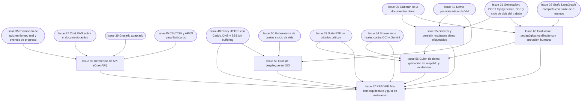

# Fase 6 — Demo y entrega

> **Objetivo de la fase**: resultados demo persistidos, guion ensayado con respaldo, README y evidencias de cumplimiento completos. **Hito H6**.
> **Duración estimada**: 3–4 días (solapa con el final de F5). · [Volver al plan maestro](../plan-implementacion.md)

**Dependencias internas de la fase:**

---

### `Issue 55` — Generar y persistir resultados demo etiquetados
**F6** · **QAD** · **M** · **Depende de**: `Issue 05`, `Issue 31`, `Issue 49` · **Referencia**: decisiones_proyecto.md §18

**Objetivo**: ejecutar y guardar todos los resultados que la demostración necesita, sobre el documento VCN y los otros dos, etiquetados como ejemplos previos.

**Tareas**:
- Ejecutar los 3 escenarios oficiales (§18.1): A) Principiante + Flashcards + General + es · B) Junior + Tutorial + E-commerce + en · C) Ejecutivo + Resumen + Fintech + pt — mismo `document_id` y hash.
- Ejecutar los complementos de §18.2: quiz con respuesta correcta e incorrecta, guion de clase, adaptación para Arquitecto, consulta de afirmación derivada del diagrama con vista de página original.
- Persistir todos los resultados en OCI (etiqueta «Ejemplo generado previamente» con fuente, fecha y parámetros).
- Registrar tiempos medidos de cada ejecución (para mostrar métricas reales — §18.3).
- Guardar el caso intencional de evidencia insuficiente (sección débil de `Issue 05`) que se bloquea correctamente.

**Preparación anticipada**: generar y revisar los escenarios desde un
documento en un espacio propio autorizado antes de la activación de 49. Conservar
el mismo ID/hash para A/B/C, todos los complementos y aprobación/persistencia
reales. La publicación, recuperación y etiqueta de ejemplos en la app siguen
siendo necesarias para cerrar el issue; no simular el catálogo ni sus resultados.

**Criterios de aceptación**:
- [x] Los 3 escenarios + complementos están persistidos en OCI y recuperables desde la app/API local, desde otra sesión y con su etiqueta.
- [x] Todos los paquetes publicados pasaron por aprobación real (ningún JSON escrito a mano); el caso rechazado conserva solo diagnóstico.
- [x] El caso de rechazo por calidad queda registrado con su diagnóstico.

**Verificación**: catálogo, originales, citas y quiz comprobados desde otra sesión contra la API local con OCI real. Evidencia: [VCN v2 y complementos](../evidencia/issue-55/v2/README.md).

**Aceptación pública diferida — 15/10/2026**: por decisión del responsable del proyecto, el cierre de este issue acredita preparación, aprobación, persistencia y recuperación real local. La comprobación de la biblioteca y sus etiquetas desde la URL pública se traslada al [seguimiento #133](https://github.com/No-Country-simulation/G10-Equipo38-NuevaMente/issues/133). No se marca como ejecutada ni se acredita VM/HTTPS o revisión humana de #60. El seguimiento debe completarse para aceptar la entrega pública.

---

### `Issue 56` — Guion de demo, grabación de respaldo y evidencias
**F6** · **QAD** · **M** · **Depende de**: `Issue 55`, `Issue 53`, `Issue 54`, `Issue 60` · **Referencia**: decisiones_proyecto.md §18.2, §18.3

**Objetivo**: guion minuto a minuto ensayado, con grabación de respaldo y la evidencia de cada diferencial.

**Tareas**:
- Guion de 10–12 min: presentación → carga/generación **en vivo real** con persistencia OCI → escenarios A/B/C → quiz interactivo → multimodal (diagrama + fuente) → exportaciones (PDF + Anki) → recuperación con código → caso de rechazo intencional → cierre.
- Grabación completa de respaldo (la grabación no sustituye la integración activa ni la prueba funcional nueva — §18.3).
- Ensayo general con cronómetro y registro de desvíos; plan B técnico (si Gemini/VM fallan: resultados precargados + grabación + explicación honesta).
- Checklist de evidencias por diferencial y por requisito mínimo, con enlaces (objetos OCI, capturas, video).
- Ejecutar el [protocolo manual E2E M1–M5](../verificacion-issue-53.md) transferido de #53 el 18/10/2026: tres adaptaciones, recuperación de historial/progreso, teclado/foco/contraste/320 px, exportaciones legibles y estados/procedencia distinguibles. Archivar capturas/video saneados y la revisión identificada de dos personas, declarando los proveedores usados.

**Trabajo en paralelo**: preparar el guion y ensayar tramos desde el inicio,
sin esperar el cierre de todas las dependencias. La grabación final y el cierre
conservan su evidencia y condiciones. Una contingencia local con proveedores
reales identifica Compute pendiente; ni video ni resultados guardados sustituyen
la integración activa o acreditan un despliegue inexistente.

**Criterios de aceptación**:
- [ ] Ensayo completo dentro del tiempo sin errores bloqueantes.
- [ ] Cada ítem del checklist §18.2 enlaza su evidencia; los tramos que requieren proveedores reales o URL pública identifican su aceptación pendiente en #133, sin declararlos ejecutados.
- [ ] El guion prevé ejecución en vivo con proveedores reales y contingencia honesta, sin prometer disponibilidad; su prueba funcional real se acepta en #133.
- [ ] Protocolo manual E2E M1–M5 ejecutado localmente, con commit/configuración, capturas/video, resultados y firma de dos personas. Trasladado de #53 por autorización del responsable el 18/10/2026; la repetición pública/real se acepta en #133 y la anotación pedagógica de #60 conserva su alcance.

**Verificación**: ensayo frente al equipo completo con retroalimentación.

**Aceptación externa trasladada — 16/10/2026**: #56 conserva guion, ensayo, cronómetro, grabación de respaldo y evidencias propias. El ensayo local declara sus proveedores; los tramos de prueba/grabación que requieren Gemini/OCI reales o la URL de entrega se completan en #133. Una grabación simulada no se presenta como integración real ni sustituye la demostración funcional exigida para la entrega.

---

### `Issue 57` — README final con arquitectura y guía de instalación
**F6** · **QAD** · **M** · **Depende de**: `Issue 48`, `Issue 53`, `Issue 54`, `Issue 55`, `Issue 56`, `Issue 58`, `Issue 59`, `Issue 60` · **Referencia**: decisiones_proyecto.md §15, §20; enunciado (requisito 8)

**Objetivo**: README de repositorio que cumple el requisito 8: arquitectura, diagrama del flujo RAG/Agentes y guía de instalación, coherentes con el sistema ejecutable.

**Tareas**:
- Portada: qué es NuevaMente, qué problema resuelve, capturas de la UI real.
- Diagrama de arquitectura (desde [`docs/arquitectura.md`](../arquitectura.md)) y diagrama del flujo RAG/Agentes.
- Guía de instalación completa: prerrequisitos, env vars (Apéndice A), `MOCK_OCI=1` local sin credenciales, Docker, y modo real con OCI+Gemini.
- Uso: los 3 escenarios de ejemplo con sus JSON de entrada/salida reales.
- Tabla de cumplimiento: 8 requisitos mínimos + 5 diferenciales + extras, cada uno con enlace a su evidencia.
- Créditos del equipo y stack.

**Criterios de aceptación**:
- [ ] Una persona fuera del equipo levanta el proyecto local siguiendo solo el README (prueba real con un voluntario).
- [ ] El diagrama refleja el sistema implementado (sin componentes que no existen).
- [ ] Todos los requisitos del enunciado aparecen con evidencia enlazada.

**Verificación**: instalación limpia por terceros + revisión final del equipo.

---

### `Issue 58` — Guía de despliegue en OCI
**F6** · **INF** · **S** · **Depende de**: `Issue 48`, `Issue 49`, `Issue 50` · **Referencia**: decisiones_proyecto.md §9, §14; diferencial 1

**Objetivo**: runbook reproducible del despliegue completo en la capa Always Free.

**Tareas**:
- Pasos de `Issue 47`/`Issue 48`/`Issue 49` consolidados: aprovisionamiento VM A1, seguridad, Docker, Caddy + DNS, variables de entorno, carga de demo.
- Verificación de la capa Always Free: qué verificar en la consola para confirmar $0 (recursos, límites).
- Recuperación ante pérdida de VM: reconstrucción del índice desde OCI (§9.3) y del estado operativo.
- Mantenimiento: actualización de imágenes con interrupción breve, backups del volumen, monitoreo mínimo.

**Criterios de aceptación**:
- [ ] La guía completa se revisa por quien no la escribió; su reproducción desde cero sobre la VM de entrega se acepta en #133, con ese integrante identificado.
- [ ] Incluye la verificación de costos $0 y el procedimiento de recuperación.

**Verificación de documentación**: revisión por un integrante que no hizo el despliegue original. La ejecución real sobre OCI, Always Free y recuperación se acepta en #133; una revisión o simulación local no demuestra que exista VM.

---

### `Issue 59` — Referencia de API (OpenAPI)
**F6** · **API** · **S** · **Depende de**: `Issue 35`, `Issue 37`, `Issue 39`, `Issue 45` · **Referencia**: decisiones_proyecto.md §7.1

**Objetivo**: referencia humana de la API completa, exportada y versionada junto al repositorio.

**Tareas**:
- Exportar `openapi.json` desde la app y commitearlo (o generar en CI).
- Página `docs/api_reference.md`: tabla de endpoints con parámetros, códigos de error estables, ejemplos `curl` de los flujos principales (crear espacio, subir, generar, SSE, quiz, exportar).
- Ejemplos de solicitud/respuesta del enunciado verificados contra la implementación real.

**Criterios de aceptación**:
- [x] El OpenAPI exportado valida en un viewer estándar.
- [x] Los ejemplos `curl` del documento funcionan tal cual contra una instancia local de la API integrada, indicando URL base configurable y los requisitos de cada ejemplo.

**Verificación**: validar el OpenAPI exportado y ejecutar los ejemplos contra la API local. No afirmar integración real cuando se usen proveedores simulados.

**Comprobación pública diferida — 15/10/2026**: la ejecución de esos mismos ejemplos contra la URL HTTPS de entrega se traslada al [seguimiento #133](https://github.com/No-Country-simulation/G10-Equipo38-NuevaMente/issues/133). No bloquea la documentación ni el cierre local de #59; permanece obligatoria para aceptar el despliegue. #59 conserva su alcance documental; su cierre acredita los criterios locales. Evidencia: [verificación #59](../verificacion-issue-59.md).

---

### `Issue 60` — Evaluación pedagógica multilingüe con anotación humana
**F6** · **QAD** (con apoyo AGT) · **L** · **Depende de**: `Issue 29`, `Issue 05`, `Issue 31` · **Referencia**: decisiones_proyecto.md §12.1, §12.2

**Objetivo**: set de casos revisados por humanos en ES/EN/PT que mide utilidad pedagógica y detecta falsos aprobados del juez automático.

**Tareas**:
- Diseñar el set: por cada idioma, casos que cubran los 4 perfiles y ≥3 formatos sobre los documentos demo.
- Anotación humana independiente (2 revisores): claridad, adecuación al perfil, cobertura, utilidad — separada del score de fidelidad (§12.2).
- Contraste juez automático vs. anotación: registrar falsos aprobados y falsos rechazados; corregir prompts/recuperación/juez y reevaluar; no bajar umbrales ni cambiar decisiones sin acuerdo explícito.
- Reporte final con resultados medidos, tamaño de muestra y configuración (sin promesas de calidad absoluta — §12.4).

**Muestra acotada**: mantener los 12 casos y dos revisores previstos,
cubriendo por idioma los perfiles y formatos exigidos. Reutilizar casos reales
de 55 cuando satisfagan la cobertura; no ampliar a todas las combinaciones
posibles. Mantener la corrección y reevaluación de falsos aprobados y un reporte
breve con configuración, muestra y resultados medidos.

**Criterios de aceptación**:
- [ ] ≥12 casos anotados por 2 revisores en los 3 idiomas.
- [ ] Todo falso aprobado detectado está corregido y reevaluado con evidencia; un issue abierto no habilita H6.
- [ ] Reporte archivado en `docs/evidencia/` con metodología.

**Verificación**: revisión del reporte por el equipo completo.
