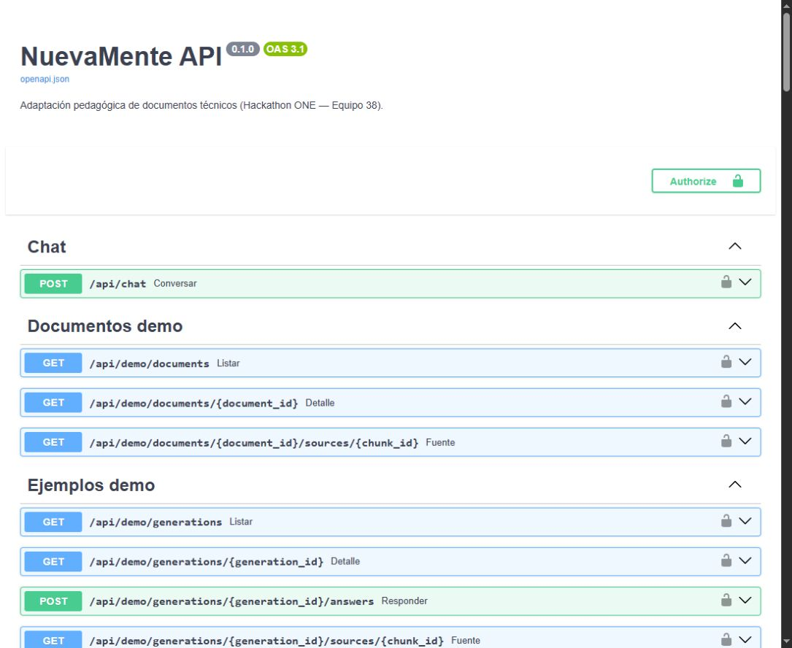

# Verificación local del issue #59

Fecha: 15 de octubre de 2026 (Argentina). PR #134, rama original
`feature/issue-59-openapi-reference`, actualizada sobre `develop` `cb26cc8`.

## Correcciones de integración

Se conservaron los metadatos OpenAPI y las rutas demo de #55 al resolver los
conflictos de imports y `.gitattributes`. La importación de `ERRORES` desde
`demo_documents` había quedado incompatible con #55; las cinco operaciones de
ejemplos demo ahora declaran metadatos por operación con los helpers compartidos.
Se documentan errores tipados, cabeceras, vista estudiante, corrección sin
progreso privado y PNG binario. No se modificaron los cuerpos ejecutables de
los handlers ni el worker, los contratos de entrada o los proveedores.

El snapshot y el índice humano cubren **37 operaciones**. La prueba de superficie
conserva una lista explícita; se agregó una regresión HTTP de catálogo, detalle,
citas, imagen inexistente y corrección del quiz demo desde otra sesión.

## Resultados

- **38 pruebas aprobadas** de OpenAPI, metadatos, demos y arranque de API.
- **8 pruebas aprobadas** del verificador de referencia, incluidos los siete
  bloques Bash literales ejecutados por curl contra la API local por TCP.
- `export_openapi.py --check` y `--validate`: snapshot reproducible, vigente y
  válido según el validador OpenAPI 3.1 con referencias locales, sin red.
- `verify_api_reference.py --check`: 37 operaciones y siete bloques en orden.
- Ruff y formato: aprobados; política de dependencias exactas y `pip check`
  aprobados. Los requisitos nuevos sólo agregaron el validador y sus dependencias.

El recorrido curl comprobó creación/recuperación del espacio, carga JSON,
ingestión y estado ready, generación, SSE común y de generación con reconexión,
quiz estudiante sin soluciones, corrección, progreso, JSON/MD/PDF, flashcards,
CSV/TSV/APKG y carga multipart. El PDF tenía cabecera válida; el APKG se abrió
como ZIP íntegro con colección SQLite. Esta última comprobación no es una
importación manual en Anki Desktop.

Herramientas utilizadas: Git Bash 5.2.37, curl 8.12.1 y jq 1.8.2. La primera
ejecución desde PowerShell resolvió `bash` al lanzador WSL sin distribución y
falló antes de ejecutar curl. Se seleccionó Git Bash mediante
`NM_API_REFERENCE_BASH`, con sus utilidades y jq disponibles en el PATH de esa
terminal. Se documentó ese requisito; no se alteraron los bloques ni las
validaciones para obtener el resultado.

## Viewer estándar

Swagger UI **5.33.2**, obtenido del registro npm y contrastado con la integridad
SHA-512 publicada, mostró el archivo versionado como `NuevaMente API 0.1.0`,
`OAS 3.1` y 37 operaciones. No hubo errores de carga/resolución ni mensajes de
error o advertencia en la consola. Se deshabilitaron el validador externo y los
botones de ejecución; el viewer sirvió sólo archivos locales, sin credenciales.

SHA-256 del snapshot visualizado:
`b815caba3fa753377e3cc7d69e7dac0ca865bab8dc1a883e3da382ec9610313a`.

## Alcance

Las pruebas usan Chroma, SQLite, grafo, worker y HTTP del proyecto con dobles
explícitos. El exportador y el verificador aíslan `.env`; no se llamó a Gemini
u OCI reales. No acredita calidad pedagógica real, VM, HTTPS público ni UI React.

No se repitió toda la suite local de Windows. El PR conserva el antecedente de
timeouts de su corrida general anterior; esta revisión no los atribuye por
inferencia al diff ni afirma una corrida general local verde. La integración
requiere que apruebe la CI del último commit del PR.

La ejecución pública de los ejemplos conserva su criterio pendiente en
[#133](https://github.com/No-Country-simulation/G10-Equipo38-NuevaMente/issues/133).
#59 acredita documentación y validación local. #33 y la migración React quedan
fuera de esta revisión.
